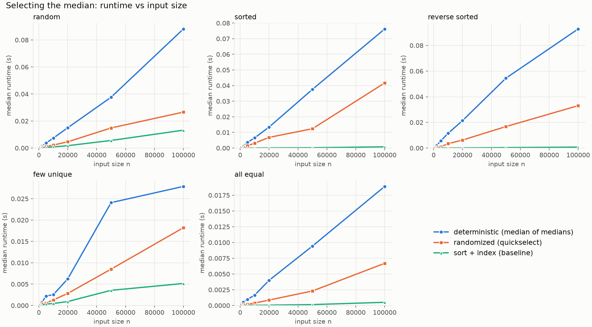
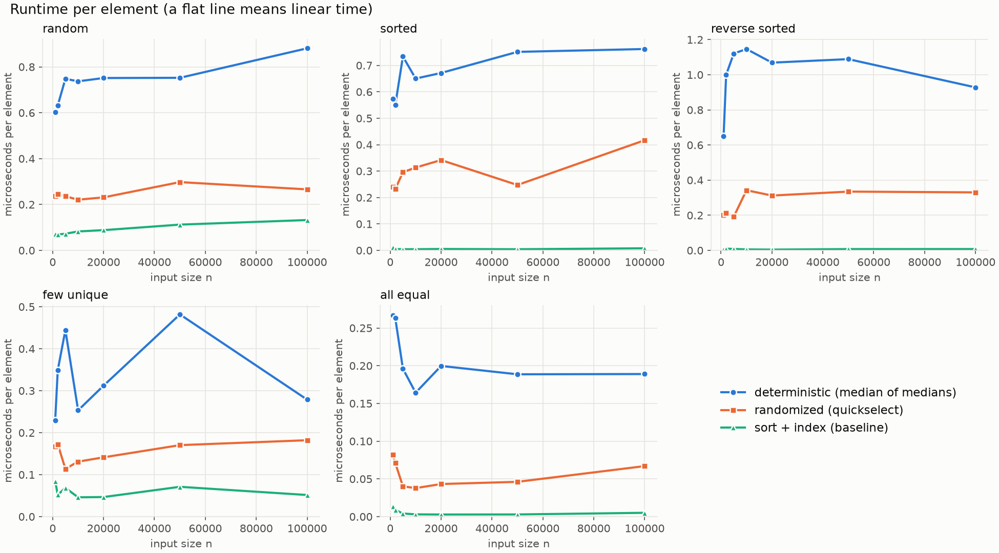
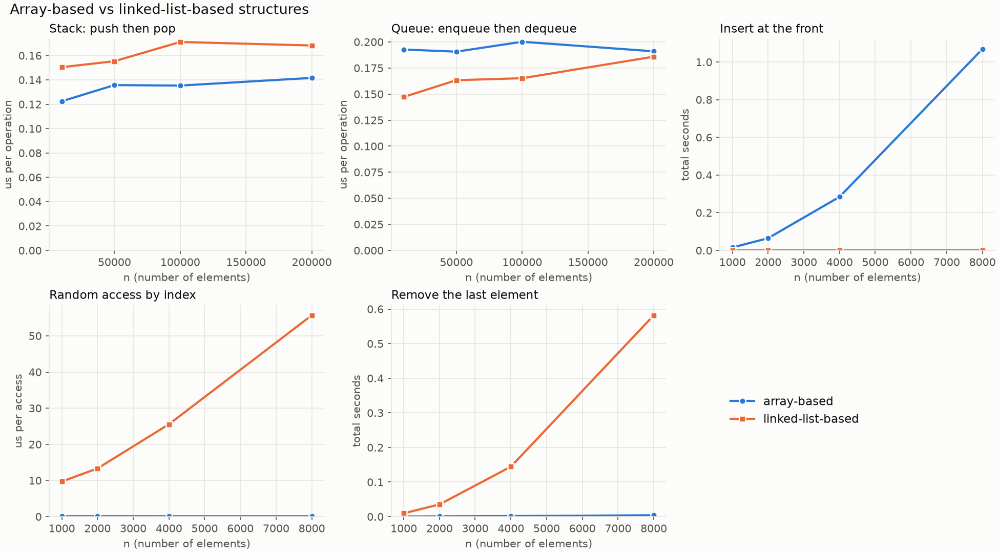

# Assignment 6: Medians and Order Statistics & Elementary Data Structures

Python implementations, tests, benchmarks and a written report for:

* **Part 1:** selecting the k-th smallest element: deterministic **Median of Medians** (worst-case O(n)) and **Randomized Quickselect** (expected O(n)), with a performance analysis and an empirical comparison.
* **Part 2:** elementary data structures built from scratch: arrays and matrices, array-based stacks and queues, singly linked lists, and (optional) rooted trees.

The full write-up, with complexity proofs, measured results and discussion, is in **[REPORT.md](REPORT.md)**.

## Repository layout

```
selection.py              Part 1: deterministic_select, randomized_select
data_structures.py        Part 2: DynamicArray, Matrix, ArrayStack, ArrayQueue,
                                  SinglyLinkedList, LinkedStack, LinkedQueue, RootedTree
benchmark_selection.py    Part 1 empirical analysis (writes results/)
benchmark_structures.py   Part 2 array-vs-linked-list measurements (writes results/)
tests/                    41 unit tests (unittest)
results/                  CSV files and figures produced by the benchmarks
REPORT.md                 the report
requirements.txt          only needed to redraw the benchmark figures
```

## Requirements

* Python 3.8 or newer should work; developed and tested on Python 3.13.
* The two implementation modules and the tests use **only the standard library**.
* `matplotlib` and `numpy` are needed only by the benchmark scripts for plots and curve fitting:

```bash
python -m pip install -r requirements.txt
```

## How to run

Run everything from the repository root. On Windows, use `py` in place of `python` if the `python` command is not recognized.

```bash
# 1. Unit tests (41 tests, under a second)
python -m unittest discover -v

# 2. Quick demos of each module
python selection.py
python data_structures.py

# 3. Part 1 benchmark (about 15 seconds) -> results/selection_*.csv, selection_*.png
python benchmark_selection.py
python benchmark_selection.py --quick        # smaller sizes, fewer repeats
python benchmark_selection.py --no-plots     # skip matplotlib

# 4. Part 2 benchmark (about 10 seconds) -> results/structure_*.csv/png
python benchmark_structures.py
```

### Using the code

```python
from selection import deterministic_select, randomized_select

data = [38, 27, 43, 3, 9, 82, 10, 3, 27]
deterministic_select(data, 5)    # 5th smallest -> 27   (k is 1-based; duplicates count separately)
randomized_select(data, 5)       # -> 27
```

```python
from data_structures import ArrayStack, ArrayQueue, SinglyLinkedList, RootedTree

s = ArrayStack(); s.push(1); s.push(2); s.pop()          # -> 2
q = ArrayQueue(); q.enqueue("a"); q.enqueue("b"); q.dequeue()   # -> "a"
ll = SinglyLinkedList([1, 2, 3]); ll.insert_front(0); list(ll)    # -> [0, 1, 2, 3]
```

## Summary of findings

**Part 1: selection**

* Both algorithms scale **linearly** on every input type tested (random, sorted, reverse-sorted, few unique values, all equal): fitted log-log slopes of runtime against n are 1.00-1.03 (deterministic) and 0.95-1.04 (randomized).
* A **three-way partition** makes inputs with many duplicates, including all-equal arrays, run in linear time (the all-equal case is the fastest input for both algorithms).
* The deterministic algorithm's worst-case guarantee costs a constant factor: it is **1.5x-3.1x slower** than randomized quickselect at n = 100,000 (for example 78.8 ms vs 27.1 ms on random input).
* The deterministic running time does not depend on k; the randomized one is cheapest for the minimum and maximum and slower for middle ranks.
* In pure Python, the C-implemented `sorted()` is faster than both at every size tested. That is a constant-factor effect of CPython, not a change in asymptotics.

**Part 2: data structures**

* Array stacks/queues (amortized O(1)) and linked stacks/queues (worst-case O(1)) perform the same within noise, about 0.1-0.2 µs per operation in CPython.
* Where complexities differ, the measurements agree with theory: inserting at the front costs Θ(n²) in total for the array but is linear for the list; indexing is O(1) for the array (0.12 µs) but grows with n for the list (5.9 µs to 52.2 µs for n from 1,000 to 8,000); removing the last element is O(1) for the array but O(n) for a singly linked list.
* A linked-list node uses about 6x the memory of an array slot (48 bytes vs 8.1 bytes in CPython, excluding the stored objects).

## Figures

Runtime of the two selection algorithms (and a sort-then-index baseline) as the input size grows, for five input types:



The same data as time per element: a flat line means linear time.



Array-based vs linked-list-based structures:



## Results files

| File | Contents |
|---|---|
| `results/selection_timings.csv` | median and min runtime for each (distribution, n, algorithm) |
| `results/selection_scaling.csv` | fitted log-log slope per (distribution, algorithm) |
| `results/selection_vs_k.csv` | runtime as the rank k varies |
| `results/selection_runtime.png`, `results/selection_per_element.png` | figures |
| `results/structure_timings.csv`, `results/structure_comparison.png` | Part 2 measurements and figure |

Absolute timings depend on the machine; the shapes and ratios are what the report analyzes.
