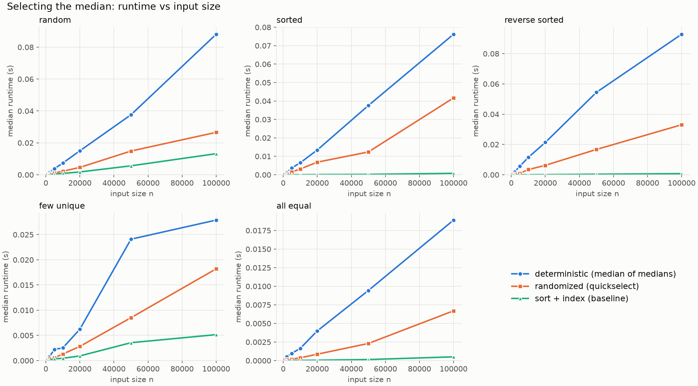
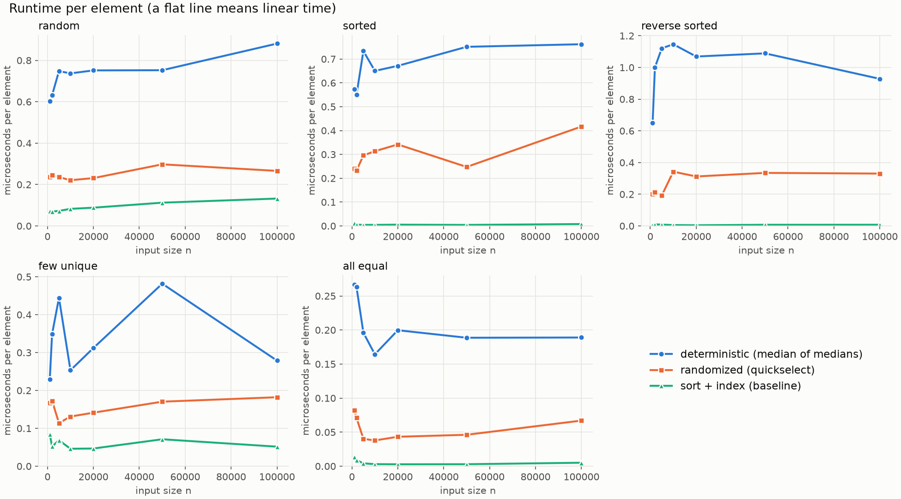
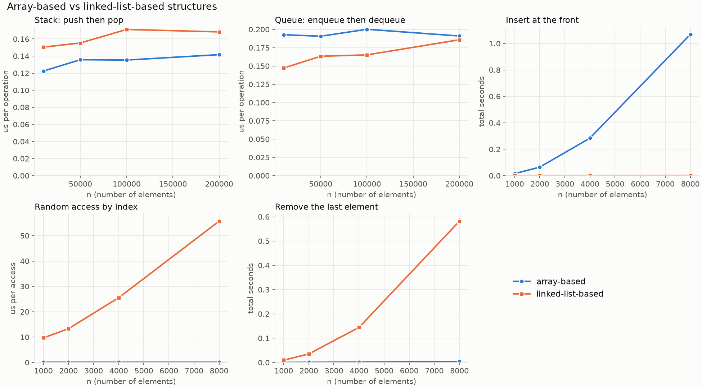

# Assignment 6: Medians and Order Statistics & Elementary Data Structures

**Name:** [Your Name] **Course:** [Course name / number] **Date:** November 22, 2026

All code is in this repository and uses only the Python standard library (matplotlib and numpy are needed only to redraw the benchmark figures). All numbers quoted below come from the CSV files in `results/`, produced by `benchmark_selection.py` and `benchmark_structures.py`. Reference: Cormen, Leiserson, Rivest, Stein, *Introduction to Algorithms*, 4th ed., Chapters 9 and 10.

**Contents**

1. [Part 1: Selection algorithms](#part-1-selection-algorithms)
2. [Part 2: Elementary data structures](#part-2-elementary-data-structures)
3. [Testing and reproducibility](#testing-and-reproducibility)

---

# Part 1: Selection algorithms

**Problem.** Given an unsorted array of `n` elements and a rank `k` (1-based), return the `k`-th smallest element. Sorting solves it in O(n log n); both algorithms below do it in O(n).

## 1.1 Implementation summary (`selection.py`)

| Function | Algorithm | Time bound |
|---|---|---|
| `deterministic_select(arr, k)` | Median of Medians (BFPRT) | O(n) **worst case** |
| `randomized_select(arr, k)` | Randomized Quickselect | O(n) **expected**, O(n²) worst case (probability vanishingly small) |

Design decisions:

* **Three-way partition (`<`, `==`, `>` pivot)** in both algorithms. This is the key to the "arrays with duplicate elements" requirement. A two-way partition puts all equal keys on one side, so an array of identical values produces a split of sizes `0` and `n-1` every time and costs Θ(n²). With a three-way partition the whole block of keys equal to the pivot is removed at once, so duplicates only make the problem easier.
* **Iterative main loop.** Both functions repeatedly narrow a window `a[lo..hi]` that must contain the answer, instead of recursing on it. The only recursion is the deterministic algorithm's call to find the median of the group medians, which works on 1/5 of the data, so depth is O(log n).
* **Works on a copy.** The caller's data is never modified (tested).
* **Input validation.** Empty input, `k` out of range (`k < 1` or `k > n`), and non-integer `k` raise `ValueError`/`TypeError`.
* **Generic ordering.** Works for ints, floats, strings, or anything supporting `<` and `>`.
* **Reproducibility.** `randomized_select` accepts an optional `random.Random` instance.

### Median of Medians, step by step

1. Split the window into groups of 5 (the last group may be smaller).
2. Insertion-sort each group (constant work per group) and move its median to the front of the window.
3. Recursively select the **median of those ⌈n/5⌉ medians**; call it `x`.
4. Partition the window three ways around `x`.
5. If `k` falls in the `== x` block, return `x`. Otherwise continue in the `<` or `>` side that contains rank `k`.

## 1.2 Time complexity analysis

### Deterministic: why O(n) in the worst case

**Pivot quality.** At least half of the ⌈n/5⌉ group medians are `≥ x`. Each of those groups (except the group containing `x` and possibly the short last group, 2 groups in total) contributes at least 3 elements `≥ x`: its median and the two larger elements in the group. So the number of elements `≥ x` is at least

```
3 * (ceil(ceil(n/5) / 2) - 2)  >=  3n/10 - 6
```

and by symmetry the same holds for elements `≤ x`. Therefore the number of elements strictly smaller than `x`, and the number strictly larger than `x`, are each at most `n - (3n/10 - 6) = 7n/10 + 6`. (The three-way partition keeps this bound true with duplicates because we only ever recurse into a strictly-smaller or strictly-larger side.)

**Recurrence.** The work per round is:

| Step | Cost |
|---|---|
| Sort ⌈n/5⌉ groups of ≤ 5 elements | O(n) |
| Recursive call for the median of medians | T(⌈n/5⌉) |
| Three-way partition | O(n) |
| Recursive call on one side | ≤ T(7n/10 + 6) |

```
T(n) <= T(ceil(n/5)) + T(7n/10 + 6) + a*n        for n >= n0,   T(n) = O(1) otherwise
```

**Solving by substitution.** Assume `T(m) <= c*m` for all `m < n`. Then

```
T(n) <= c*(n/5 + 1) + c*(7n/10 + 6) + a*n
      =  9cn/10 + 7c + a*n
      =  c*n + ( -cn/10 + 7c + a*n )
```

The bracket is `<= 0` whenever `c >= 10*a*n / (n - 70)`. For `n >= 140` this holds with `c = 20a`, and the base cases `n < 140` can be absorbed into `c` as well. Hence **T(n) = O(n) in the worst case**, independent of the input order, the input values, and `k`.

**Why groups of 5?** The two subproblem sizes add up to `n/5 + 7n/10 = 9n/10 < n`, which is what makes the recurrence linear. With groups of 3 the sizes would add up to `n/3 + 2n/3 = n`, and the same argument no longer gives a linear bound.

### Randomized: why O(n) in expectation

Each pivot is chosen uniformly at random from the current window of size `m`, so its rank is uniform over `1..m`. In the worst case the algorithm continues into the larger side, whose size is `max(r - 1, m - r)`. Each size from ⌈m/2⌉ to m-1 occurs for two of the `m` possible pivots, giving

```
E[T(n)] <= (2/n) * sum_{j = floor(n/2)}^{n-1} E[T(j)]  +  a*n
```

Substituting `E[T(j)] <= c*j`:

```
E[T(n)] <= (2c/n) * (3n^2/8)  +  a*n   =   3cn/4 + a*n   =   c*n - (cn/4 - a*n)   <=   c*n      when c >= 4a
```

so **E[T(n)] = O(n)**. The expectation is over the algorithm's own random choices, not over the input distribution: no particular input (sorted, reverse-sorted, all-equal, ...) is bad for it. The Θ(n²) worst case needs pivots that are repeatedly near the extremes, which becomes exponentially unlikely as `n` grows. As a known result (Knuth, *TAOCP* Vol. 3), the expected number of comparisons is about `2n` for the minimum or maximum and about `2(1 + ln 2)n ≈ 3.4n` for the median.

## 1.3 Space complexity and overhead

| | Deterministic | Randomized |
|---|---|---|
| Working storage | one copy of the input, O(n) (partitioning is in place inside the copy) | one copy of the input, O(n) (partitioning is in place) |
| Extra storage beyond the copy | O(log n): nested pivot-selection calls shrink by 5x each level, about log₅ n frames | **O(1)**: the main loop is iterative |
| Constant-factor overhead | high: an extra pass to sort every group of 5, a recursive call on n/5 elements, then the partition | low: one partition pass per round |
| Random numbers | none | one `randint` call per round |

The copy exists only so the caller's list is not modified. If the caller allows modification, both algorithms can run in place with the extra-space figures in the third row. Python also pays per-element interpreter overhead for the group sorting, which is why the deterministic algorithm's constant is visible in the measurements below.

## 1.4 Empirical analysis

**Method.** `benchmark_selection.py` times three methods: `deterministic_select`, `randomized_select`, and a baseline that sorts and indexes, `sorted(a)[k-1]`. Sizes: n = 1,000 to 100,000. Distributions:

* **random:** a random permutation of distinct values
* **sorted**
* **reverse sorted**
* **few unique:** 10 distinct values, so many duplicates
* **all equal**

`k` is the median, `(n+1)//2`, unless stated. Each cell is the **median of 5 runs** (garbage collection disabled during timing; the randomized algorithm uses a different seed for each run). **Every configuration's answer is checked against `sorted(data)[k-1]`** and the benchmark aborts on a mismatch. Environment: CPython 3.13, one machine; absolute times will differ on yours, but the shapes and ratios are what matter.

### Runtime vs input size



Median runtime in milliseconds, **random input**:

| n | deterministic | randomized | sort + index |
|---:|---:|---:|---:|
| 1,000 | 0.71 | 0.29 | 0.08 |
| 2,000 | 1.39 | 0.56 | 0.17 |
| 5,000 | 3.70 | 1.23 | 0.45 |
| 10,000 | 7.56 | 2.51 | 1.03 |
| 20,000 | 14.53 | 5.16 | 2.27 |
| 50,000 | 38.11 | 13.82 | 6.30 |
| 100,000 | 78.82 | 27.09 | 14.46 |

All distributions at **n = 100,000** (ms):

| distribution | deterministic | randomized | sort + index | deterministic / randomized |
|---|---:|---:|---:|---:|
| random | 78.8 | 27.1 | 14.46 | 2.9x |
| sorted | 64.9 | 26.6 | 0.65 | 2.4x |
| reverse sorted | 74.7 | 32.8 | 1.13 | 2.3x |
| few unique | 27.7 | 18.2 | 6.01 | 1.5x |
| all equal | 17.0 | 5.4 | 0.60 | 3.1x |

### Is it really linear?

If runtime is `c * n^p`, then the slope of `log(time)` against `log(n)` is `p`: a slope of 1 means linear and 2 means quadratic. Fitted over the 7 sizes:

| distribution | deterministic | randomized | sort + index |
|---|---:|---:|---:|
| random | 1.023 | 0.992 | 1.127 |
| sorted | 1.025 | 0.993 | 0.974 |
| reverse sorted | 1.024 | 1.039 | 1.107 |
| few unique | 1.008 | 1.027 | 0.974 |
| all equal | 1.003 | 0.951 | 0.952 |



The time **per element** stays essentially flat as n grows 100-fold (random input: deterministic 0.71 → 0.79 µs, randomized 0.29 → 0.27 µs per element), which is what linear time looks like.

### Effect of the rank k (random input, n = 100,000, ms)

| rank k | deterministic | randomized | sort + index |
|---|---:|---:|---:|
| k = 1 (min) | 83.7 | 18.8 | 15.6 |
| k = n/4 | 83.9 | 26.3 | 15.5 |
| k = n/2 (median) | 82.1 | 31.4 | 15.9 |
| k = 3n/4 | 84.0 | 34.9 | 15.9 |
| k = n (max) | 84.1 | 17.4 | 15.6 |

### Observations, related to the theory

1. **Both selection algorithms scale linearly**, on every input type, matching the O(n) analysis. Fitted exponents are 1.00-1.03 for the deterministic algorithm and 0.95-1.04 for the randomized one (the randomized spread is partly timing noise at small n).
2. **Input order does not matter.** Sorted and reverse-sorted inputs, the classic bad cases for a quickselect that picks the first or last element as pivot, show no slowdown for the randomized version because its pivot is random. The deterministic algorithm's guarantee is likewise independent of order.
3. **Duplicates are handled in linear time.** The all-equal input is the fastest case for both selection algorithms (17.0 ms and 5.4 ms, versus 78.8 ms and 27.1 ms on random input): after one three-way partition the pivot's equal block contains `k` and the algorithm returns. With a two-way partition this input would be quadratic. On the few-unique input the deterministic timings are less smooth (note the jump between 20,000 and 50,000 in the figure) because the algorithm stops as soon as the pivot's equal block covers `k`, and whether that happens in the first round or a later one depends on how the 10 values happen to be distributed.
4. **Worst-case guarantee costs a constant factor.** Deterministic is **1.5x to 3.1x slower** than randomized at n = 100,000, matching the extra work described in 1.3 (sorting groups, building and recursing on the medians). Randomized Quickselect is the better practical choice unless a hard worst-case bound is required.
5. **Dependence on k.** The deterministic running time is the same for every k (82-84 ms), as expected from an analysis that does not depend on k. The randomized algorithm is cheapest at the extremes, k = 1 and k = n (17-19 ms), and costs more for ranks in the middle (26-35 ms), consistent with the expected-comparison counts of about 2n for extremes and about 3.4n for the median. (The ordering among the middle ranks is within what random pivots and this implementation's asymmetric swap costs can produce, so I do not read anything into it.)
6. **Python's built-in sort beats both here.** `sorted()` is written in C, so its much smaller constant factor outweighs the extra log n at every size tested (and on already-sorted data it is O(n) because Timsort detects runs). This is a statement about constant factors in CPython, not about asymptotics: O(n) selection overtakes O(n log n) sorting when both are implemented at the same level, such as in a compiled language, but I did not measure that here. Selection is also the only option when the data should not be fully sorted or when only the order statistic is needed.

---

# Part 2: Elementary data structures

## 2.1 Implementation summary (`data_structures.py`)

Everything is built from scratch. The only Python container used is a plain fixed-size `list` as a **raw block of memory** (`[None] * capacity`); the built-in `append`, `insert`, `pop` and `collections.deque` are not used to do the work. Resizing, shifting and pointer manipulation are written by hand.

| Structure | Class | Notes |
|---|---|---|
| Array | `DynamicArray` | access, `append`, `insert`, `delete`, `pop`, `index`; capacity doubles when full and halves at 1/4 full |
| Matrix | `Matrix` | `get`, `set`, `insert_row`, `delete_row`, `transpose`; rows are fixed blocks held in a `DynamicArray` |
| Stack (array) | `ArrayStack` | `push`, `pop`, `peek`; `top` index |
| Queue (array) | `ArrayQueue` | `enqueue`, `dequeue`, `front`; **circular buffer** with `head` and modular arithmetic |
| Linked list | `SinglyLinkedList` | head and tail pointers; insert at front/back/after a node/at an index; delete front/back/at an index/by value; search; traversal; reverse |
| Stack, queue (list) | `LinkedStack`, `LinkedQueue` | same interface as the array versions, built on `SinglyLinkedList`, for the comparison |
| Rooted tree (optional) | `RootedTree`, `TreeNode` | **left-child / right-sibling** representation (CLRS 10.3); iterative preorder, level-order, height, find, remove subtree |

Design decisions:

* **Doubling and halving.** Growing by a constant factor makes `append`/`push`/`enqueue` amortized O(1): n pushes copy at most `1 + 2 + 4 + ... < 2n` elements in total, so the total cost is under 3n. Shrinking happens at **one quarter** full (not one half), so a stack that hovers around a size boundary cannot trigger a resize on every other operation.
* **Circular queue.** Using `(head + size) % capacity` means neither enqueue nor dequeue ever shifts elements. A naive array queue that removes from index 0 is O(n) per dequeue.
* **Tail pointer.** It makes `insert_back` O(1), so the linked queue's enqueue is O(1). A *singly* linked list still cannot delete the tail in O(1) (it must find the predecessor), which the experiment below confirms.
* **Matrix rows as separate blocks.** `get`/`set` are O(1), and inserting or deleting a row moves row *references* instead of every element.
* **Left-child / right-sibling trees.** Every node has exactly three pointers (`parent`, `left_child`, `right_sibling`) no matter how many children it has, so a node with an unbounded number of children costs O(1) space. Traversals are iterative (using the `ArrayStack` and `ArrayQueue`), so a 5,000-level-deep tree does not hit Python's recursion limit (tested).
* **Errors.** Out-of-range indexes and operations on empty structures raise `IndexError` with a clear message.

## 2.2 Time complexity of the basic operations

*n* = current number of elements.

| Structure | Access by index | Insert | Delete | Search |
|---|---|---|---|---|
| `DynamicArray` | O(1) | end: O(1) amortized; at position *i*: O(n - i) | last: O(1) amortized; at position *i*: O(n - i) | O(n) |
| `Matrix` (r x c) | O(1) | row: O(c + r - i) | row: O(c + r - i) | O(r·c) |
| `ArrayStack` | peek: O(1) | push: O(1) amortized | pop: O(1) amortized | n/a |
| `ArrayQueue` | front: O(1) | enqueue: O(1) amortized | dequeue: O(1) amortized | n/a |
| `SinglyLinkedList` | O(index) | front: O(1); back: O(1) (tail pointer); after a known node: O(1); at index: O(index) | front: O(1); back: **O(n)**; at index: O(index); by value: O(n) | O(n) |
| `LinkedStack` | peek: O(1) | push: O(1) worst case | pop: O(1) worst case | n/a |
| `LinkedQueue` | front: O(1) | enqueue: O(1) worst case | dequeue: O(1) worst case | n/a |
| `RootedTree` | n/a | add child: O(d) (d = children of the parent) | remove subtree: O(d + s) (s = subtree size) | find: O(n); traversals: O(n) |

Matrix transpose is O(r·c). Linked-list reverse is O(n) time and O(1) space.

## 2.3 Array vs linked list for stacks and queues

**Theory.** All four stack/queue implementations offer O(1) operations. The differences are in the *kind* of O(1):

| | Array-based | Linked-list-based |
|---|---|---|
| Cost guarantee | **amortized** O(1): an occasional push/enqueue triggers an O(n) copy | **worst-case** O(1): no operation ever copies the structure |
| Memory per element | 1 slot, plus unused capacity (in my implementation the capacity is at most 4x the number of elements, reached just before a shrink) | 1 node (value + `next`) plus allocator overhead per element |
| Allocation | rare, in large blocks | one allocation per element |
| Locality | elements contiguous in memory | nodes scattered in memory (in C/C++ this hurts cache performance considerably) |
| Max size | grows as needed, but needs a contiguous block | grows one node at a time |

**Measured.** Time per operation (push+pop and enqueue+dequeue workloads, µs per operation):

| n | array stack | linked stack | array queue | linked queue |
|---:|---:|---:|---:|---:|
| 10,000 | 0.12 | 0.14 | 0.19 | 0.14 |
| 50,000 | 0.13 | 0.15 | 0.19 | 0.15 |
| 100,000 | 0.12 | 0.24 | 0.19 | 0.17 |
| 200,000 | 0.17 | 0.16 | 0.21 | 0.16 |

Both implementations are flat in n, as the O(1) analysis predicts, and neither wins consistently: the differences (0.1 to 0.2 µs per operation) are within run-to-run noise (for example the linked stack at n = 100,000 is a clear outlier against its neighbors). In CPython the interpreter overhead of the method calls dominates the cost of the memory layout.

**Memory.** Measured with `sys.getsizeof`: an array slot costs **8.1 bytes** (one pointer) while a linked-list node costs **48 bytes**, about **6x more per element**, before counting the stored object itself. The array's slack (unused capacity) partially offsets this, but a linked structure still uses noticeably more memory per element.



## 2.4 Comparing the structures where their costs differ

Total or per-operation times from `benchmark_structures.py` (median of 3 runs):

**Insert at the front** (n insertions; array = `DynamicArray.insert(0, x)`, list = `insert_front`):

| n | array total (ms) | linked total (ms) |
|---:|---:|---:|
| 1,000 | 23.2 | 0.1 |
| 2,000 | 53.0 | 0.3 |
| 4,000 | 346.1 | 0.9 |
| 8,000 | 948.6 | 1.2 |

Every array insertion shifts all existing elements, so n insertions cost Θ(n²) in total. Measured time grows clearly faster than linearly (8x the elements costs about 41x the time, between linear and the ideal 64x for a quadratic, because small sizes carry fixed overhead). The linked list stays tiny and linear.

**Random access by index** (2,000 random reads):

| n | array (µs per access) | linked (µs per access) |
|---:|---:|---:|
| 1,000 | 0.12 | 5.89 |
| 2,000 | 0.11 | 12.04 |
| 4,000 | 0.12 | 24.35 |
| 8,000 | 0.12 | 52.23 |

The array is constant (O(1)); the linked list grows in proportion to n (O(n): the average walk is n/2 nodes).

**Remove the last element** (n times):

| n | array (µs per op) | singly linked (µs per op) |
|---:|---:|---:|
| 1,000 | 0.39 | 9.26 |
| 2,000 | 0.41 | 18.19 |
| 4,000 | 0.39 | 36.37 |
| 8,000 | 0.38 | 72.35 |

The array pop is O(1); the singly linked `delete_back` must walk to the predecessor of the tail, O(n). A doubly linked list would fix this at the price of a second pointer per node.

## 2.5 Practical applications and when to prefer each structure

| Structure | Typical real-world uses |
|---|---|
| **Array / dynamic array** | Anything indexed or scanned: lookup tables, buffers, sorting and binary search, columns of data, the storage behind most "list" types in high-level languages |
| **Matrix (2-D array)** | Images and grids, adjacency matrices for dense graphs, numerical and machine-learning computations, game boards, spreadsheets |
| **Stack** | The function call stack, undo/redo, backtracking and depth-first search, balanced-bracket and expression parsing, browser back history. (The `RootedTree` traversal here uses a stack to avoid recursion.) |
| **Queue** | Breadth-first search, task and job scheduling, print and request queues, producer/consumer buffers; the circular buffer layout is standard for I/O and streaming buffers with a fixed capacity |
| **Singly linked list** | Chaining in hash tables, free lists in memory allocators, adjacency lists for sparse graphs, queues where O(1) worst case is required, any sequence with many insertions/removals at positions you already hold |
| **Rooted tree (left-child/right-sibling)** | File-system directories, organization and role hierarchies, the DOM of a web page, parse trees, any hierarchy where nodes have an unpredictable number of children |

**Choosing between them:**

* **Need `a[i]` by position, or a lot of scanning?** Use an **array**: O(1) access, compact memory, contiguous layout.
* **Frequent insertions or deletions in the middle or at the front, at positions you already hold?** Use a **linked list** (O(1) once you have the node) rather than shifting elements (O(n)).
* **Must every single operation be fast (real-time, latency-sensitive)?** Prefer the **linked** versions (worst-case O(1)); the array versions have occasional O(n) resizes, even though their average is O(1).
* **Memory-constrained or very many small elements?** Prefer **arrays**: 8 bytes vs 48 bytes per element in the measurement above.
* **Size known or bounded in advance?** A **fixed or pre-sized array** avoids all resizing.
* **Ease of implementation:** array stacks and queues are the simplest (an index or two); linked lists need careful pointer handling (head, tail, and empty-list cases) but are less affected by growth.
* **Hierarchies with variable fan-out:** use the **left-child/right-sibling tree**: constant space per node, at the cost of O(d) child lookup.

---

# Testing and reproducibility

* `tests/test_selection.py` and `tests/test_data_structures.py`: **41 unit tests**, all passing (`python -m unittest discover -v`).
  * Selection: every rank k for 37 different sizes between 1 and 101, including boundaries around multiples of 5; all-equal, heavy-duplicate, sorted, reverse-sorted and "organ pipe" inputs; negatives, floats, strings; invalid `k` and empty input; input not mutated; 300 randomized comparisons against `sorted()`; a 50,000-element all-equal case (which would be quadratic with a two-way partition).
  * Data structures: randomized **differential tests** against Python's built-in `list` (arrays, stacks, circular queues, linked lists under thousands of random operations), tail-pointer edge cases, resizing and shrinking, matrix row operations, tree traversals/removal, and a 5,000-level-deep tree.
* Benchmarks verify the selection answer in every configuration, use fixed random seeds, and write all raw measurements to `results/*.csv`.
* To regenerate everything: see the README.

**Limitations.** Timings are from a single machine and one CPython version, so absolute numbers will differ elsewhere. The log-log slopes use only 7 sizes, and the array-vs-list stack/queue comparison is dominated by interpreter overhead rather than memory layout. Memory figures describe CPython on a 64-bit build.
